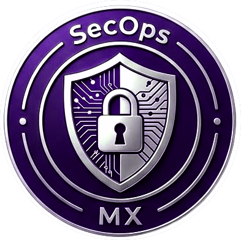

# NETWORKING

## Fundamentos, Arquitecturas y Despliegue Práctico.

Una aproximación técnico-didacta, desde la capa física, a las
arquitecturas modernas, Zero Trust, SD-WAN, VPN, monitoreo y
herramientas Linux.

#### Edición 1, 2026. Guillermo Castillo

{ .portada }

# LABORATORIO

En este repositorio encontrarás una serie de laboratorios prácticos
desarrollados de manera que puedas llevar la teoría a la práctica. Los
ejercicios están diseñados a la par de los temas de la obra, enfocados
para trabajar en entornos Linux, Windows o desde cualquier terminal o
consola.

{ .portada }

## Accede escaneando el código QR

### Para acceder directamente visita 

#### [asideloko.github.io/Networking-Lab](https://github.com/asideloko/Networking-Lab)
